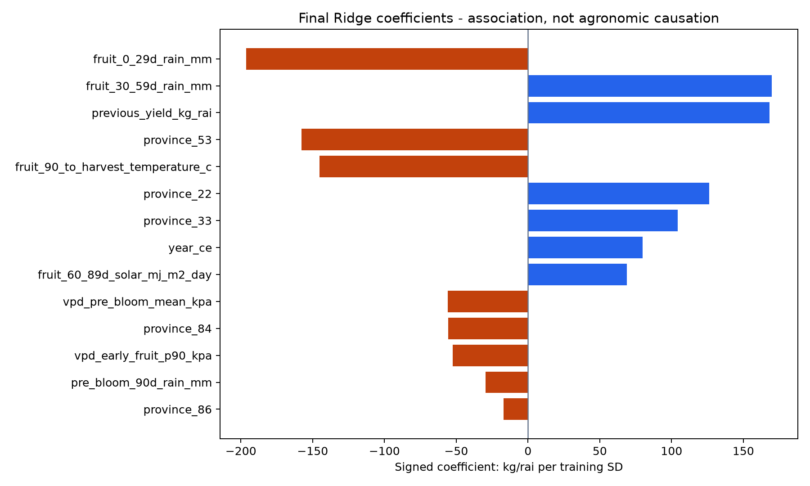
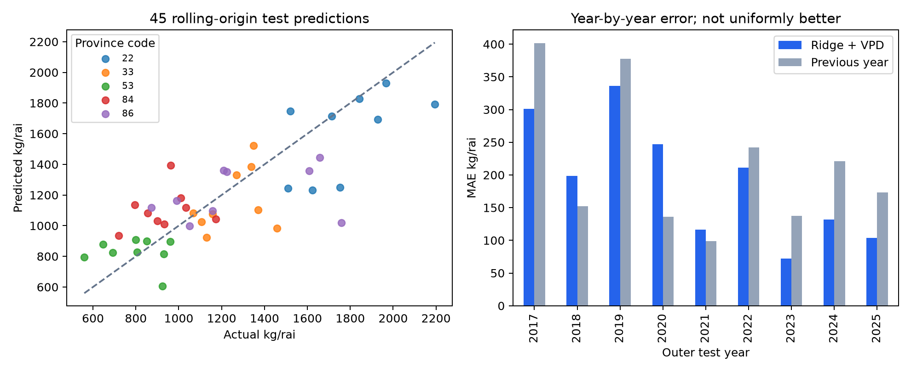

# รายงานการทำนายผลผลิตทุเรียนด้วย Ridge และอากาศตามช่วงอายุผล


## ภาพรวมและวัตถุประสงค์

### รายงานโมเดลผลผลิตทุเรียน 5 จังหวัด

Ridge Regression ใช้อากาศตามช่วงอายุผล พร้อมประเมินการเพิ่ม VPD
ข้อมูลปี 2010-2025 (พ.ศ. 2553-2568) | จัดทำ 9 ตุลาคม 2569

วัตถุประสงค์: ทดลองประมาณผลผลิตต่อไร่จากผลผลิตปีก่อน แนวโน้มปี จังหวัด และอากาศย้อนหลังที่นับจากช่วงเก็บเกี่ยว เพื่อสร้าง workflow ที่รันซ้ำได้ และตรวจสอบว่าให้ผลดีกว่าการอ้างผลผลิตปีก่อนหรือไม่

| ผลหลัก | ค่าจากการรันซ้ำ |
| --- | --- |
| โมเดลที่เลือก | stage_ridge_vpd |
| ข้อมูลทั้งหมด | 80 จังหวัด-ปี ใน 5 จังหวัด |
| ทดสอบเดินหน้าตามเวลา | 2017-2025 รวม 45 จังหวัด-ปี |
| MAE (กก./ไร่) | 190.87 |
| RMSE (กก./ไร่) | 243.42 |
| ลด MAE เทียบค่าปีก่อน | 11.44% |

### เหตุผลที่เลือกโมเดลนี้

ใช้ MAE เป็นเกณฑ์หลัก จากผลเปรียบเทียบเดิม 26 วิธี/ชุดผลบน test rows เดียวกัน Ridge + VPD มี MAE ต่ำที่สุด ตารางประเมินรวม CatBoost, Extra Trees และ SVR และแสดงครบ 26 วิธีในภาคผนวก โมเดลที่เพิ่ม NDVI มี RMSE ดีกว่า แต่ MAE สูงกว่า จึงไม่มีผู้ชนะทั้งสองเกณฑ์พร้อมกัน

ช่วง 2010-2025 เลือกตามปฏิทินเพื่อเน้นปีหลัง ไม่ลบปีที่ผลผลิตต่ำ ข้อความว่าอากาศแปรปรวนมากขึ้นเป็นคำถามวิจัย ไม่ใช่ข้อสรุปที่พิสูจน์แล้วจากการเลือกช่วงปีนี้

สถานะ: งานทดลองย้อนหลัง กันปี test ออกจากการเทรนในแต่ละ fold แต่ใช้ผลชุดนี้เลือกกลุ่มโมเดลแล้ว จึงไม่ใช่ชุดยืนยันอิสระ ตัวเลขลด MAE 11.44% เป็นผลเชิงพรรณนา อาจมองดีเกินจริงจากการเลือกผู้ชนะ และยังไม่ได้พิสูจน์ความเหนือกว่าทางสถิติหรือใช้วินิจฉัยสุขภาพต้น


## ข้อมูลและหน่วยวิเคราะห์

### Data Understanding

หนึ่งแถวเป้าหมายคือหนึ่งจังหวัดในหนึ่งปี ได้แก่ จันทบุรี (22) ศรีสะเกษ (33) อุตรดิตถ์ (53) สุราษฎร์ธานี (84) และชุมพร (86) รวม 5 × 16 = 80 แถว ไม่มีการสร้าง target รายอำเภอหรือรายชุดดินจากการแจกยอดจังหวัด

```python
yield_kg_per_rai = production_tonnes * 1000 / bearing_rai
```

| ข้อมูลใน repo | ใช้ทำอะไร |
| --- | --- |
| production_annual.csv | ยอดจังหวัด เนื้อที่ให้ผล และ target 2010-2025; lag ใช้ปี 2009-2024 |
| harvest_monthly.csv | เลือกเดือน peak เฉพาะปี train; เดือนที่ไม่มีระเบียนไม่ใช่ศูนย์ |
| weather_daily.csv | NASA POWER อุณหภูมิ ฝน RH และรังสีดวงอาทิตย์ ณ จุดอ้างอิง |
| OAE SOURCE.md / XLSX | หลักฐาน edition ต้นทาง; CSV เก็บ snapshot ไม่ได้ดึงใหม่รอบนี้ |

ใช้เนื้อที่ให้ผล (bearing area) เป็นตัวหาร ไม่ใช่เนื้อที่ยืนต้น/ปลูกทั้งหมด จึงไม่เอาพื้นที่ปลูกใหม่ที่ยังไม่ให้ผลมาลดค่าผลผลิตต่อไร่ แต่ยังอาจมีผลจากสัดส่วนอายุต้นและพันธุ์ที่ไม่ได้วัด

### ตรวจปีและสถานะข้อมูล

ตรวจไฟล์ OAE ต้นฉบับในเครื่อง: ปี 2540-2568 และ data_date 14 ก.ค. 2026; แฟ้มรายเดือนมีปี 2547-2568 และ data_date 22 ก.ค. 2026 หน้าแคตตาล็อกยังระบุสิ้นสุด 2567 จึงอ้างปีจากไฟล์และเก็บความต่างนี้ไว้ data_date ไม่ใช่ปีผลผลิต [1][2]

Target เป็นค่าที่มีบันทึกในแหล่งทางการ ไม่ใช่ค่าจำลอง อย่างไรก็ตามไฟล์ไม่ได้ใส่สถานะ final/forecast แยกทุกแถว รอบนี้ยังไม่ได้ยืนยันยอดปิดจริงทุกปีจากหน่วยงาน ผลจึงอ้าง snapshot ของโครงการ ไม่รับรอง finality ของทุกแถว

อากาศเป็นวัน LST และกริด NASA POWER หนึ่งพิกัดต่อจังหวัด ไม่ใช่สถานีสวน ไม่ใช่ค่าเฉลี่ยถ่วงด้วยพื้นที่สวนที่ให้ผล การเพิ่มความละเอียดแผนที่ไม่ได้เพิ่มความละเอียด target [3]


## ขั้น 0 และ 1: ตรวจข้อมูลและแบ่งปี

### Step 0 - Audit Data

ไฟล์: step0_audit_data.py ตรวจ key จังหวัด-ปีซ้ำ ค่าตัวเลข finite พื้นที่ให้ผล > 0 ผลผลิต >= 0 และสูตร target ให้ตรงกัน ตรวจให้ได้ 80 แถว แบ่งปีด้วยปฏิทิน และสร้างผลผลิตปีก่อนโดยเลื่อน key ปี +1

```python
lag = annual[['province_code', 'year_ce', TARGET]].copy()
lag = lag.rename(columns={TARGET: 'previous_yield_kg_rai'})
lag['year_ce'] += 1
# Merge on province/year, validate='one_to_one'
```

ผลลัพธ์: ridge_vpd_panel.csv และ ridge_vpd_audit.json มี SHA256 ของ input ทั้งสามไฟล์ ขั้นถัดไปตรวจ snapshot ทุกครั้ง ถ้าต้นทางเปลี่ยนต้องรัน pipeline ใหม่ ไม่ปนโมเดลเก่ากับข้อมูลใหม่

### Step 1 - Chronological Split

ไฟล์: step1_split_years.py ใช้ outer test ปี 2017-2025 ปีละ 5 จังหวัด สำหรับ test ปี t ใช้ train 2010 ถึง t-1 และ inner validation สามปี t-3, t-2, t-1 แต่ละ inner fold เทรนเฉพาะปีก่อน validation นั้น

| ตัวอย่าง test ปี 2025 | ช่วงปี |
| --- | --- |
| Inner validate 2022 | train 2010-2021 |
| Inner validate 2023 | train 2010-2022 |
| Inner validate 2024 | train 2010-2023 |
| Refit ก่อน test | train 2010-2024 รวม 75 แถว |
| Outer test | 2025 รวม 5 แถว |

แบ่งปีตามเวลาเพื่อหลีกเลี่ยงข้อมูลอนาคตย้อนเข้าสู่ train การ tune อายุ/alpha ของแต่ละ fold ใช้เฉพาะปีอดีต อย่างไรก็ตามผล outer test เคยใช้เลือกกลุ่มโมเดล จึงไม่ใช่ชุดยืนยันอิสระสำหรับการเลือกกลุ่มนั้น


## ขั้น 2: สร้างอากาศตามช่วงอายุผลและ VPD

### Step 2 - Process Data

ไฟล์: step2_process_data.py หาผลรวมยอดรายเดือนเฉพาะปี train ของจังหวัดนั้น เลือกเดือน peak และช่วง 3 เดือนต่อเนื่องรอบ peak หากติดขอบปีจะเลื่อนช่วงให้ยังอยู่ในปีเดียว นี่เป็นฤดูอ้างอิง ไม่ใช่ฤดูที่วัดจริงทุกปี

ให้ทุกวันที่เป็นไปได้ในช่วงเก็บเกี่ยวมีน้ำหนักเท่ากัน สำหรับ harvest day H และอายุสมมติ A วัน ให้วันดอกบานอ้างอิง B = H - A จากนั้นสร้าง exposure แต่ละ window ไม่ได้ให้น้ำหนักตามจำนวนผลจริงหรือยอดรายเดือนของ test ปีนั้น

| Feature / ช่วงเทียบ B | วิธีรวมและหน่วย |
| --- | --- |
| pre_bloom_90d_rain_mm: [-90, 0) | ค่าเฉลี่ยผลรวมฝน 90 วันต่อ harvest scenario (มม.) |
| fruit_0_29d_rain_mm: [0, 30) | ค่าเฉลี่ยผลรวมฝน 30 วัน (มม.) |
| fruit_30_59d_rain_mm: [30, 60) | ค่าเฉลี่ยผลรวมฝน 30 วัน (มม.) |
| fruit_60_89d_solar_mj_m2_day: [60, 90) | รังสีเฉลี่ยรายวัน (MJ/m²/day) |
| fruit_90_to_harvest_temperature_c: [90, A) | อุณหภูมิเฉลี่ย (°C) |
| vpd_pre_bloom_mean_kpa: [-90, 0) | VPD เฉลี่ยทุก day-scenario (kPa) |
| vpd_early_fruit_p90_kpa: [0, 30) | percentile 90 ทุก day-scenario (kPa) |

```python
e(T) = 0.6108 * exp(17.27*T / (T + 237.3))
es = (e(Tmin) + e(Tmax)) / 2
VPD = es * (1 - RHmean/100)  # kPa, approximate
```

สูตรใช้แนวทาง FAO-56 แต่ RH เฉลี่ยรายวันของ NASA ไม่ใช่ค่าเฉลี่ย RHmax/RHmin ตามสมมติฐาน Eq.19 จึงเป็น proxy ไม่ใช่ VPD รายชั่วโมงหรือที่ใบ [4] ไม่มี threshold ลูกร่วงที่ยืนยันสำหรับทุเรียนใส่ลงไป

ทดลอง A = 120, 130, 140, 150 วัน และ season cutoffs 2013-2025 ได้ 4,160 feature rows แต่ยังมี target อิสระเพียง 80 แถว หน้าต่างต้องมีข้อมูลครบ ไม่เติม missing ด้วย 0 ไม่ใช้ไฟล์ดิน/NDVI/ภัยพิบัติที่ยังไม่เข้าคู่ในโมเดลนี้


## ขั้น 3: เทรน Tune และบันทึกโมเดล

### Step 3 - Train Model

ไฟล์: step3_train_model.py ใช้ Ridge Regression โดยนำฟังก์ชันเดิมของโปรเจกต์มาใช้ซ้ำ จัด province เป็น 5 one-hot columns รวม year, lag yield, weather 5 ตัว และ VPD 2 ตัว เป็น 14 design columns

```python
z = (X - mean_train) / std_train
minimize sum((y - intercept - z @ beta)**2)
         + alpha * sum(beta**2)
y_hat = max(0, intercept + z @ beta)
```

fit mean/std และ coefficient เฉพาะ train; std = 0 เปลี่ยนเป็น 1 ไม่มี scaling จาก test ไม่ใช้ผลผลิตปีปัจจุบันเป็น predictor Tune 4 อายุ × 3 alpha (1, 10, 100) = 12 configurations เลือก mean MAE ของสาม inner years แล้ว refit train ก่อน outer year [5]

| Outer test | Train ถึง | อายุ (วัน) | alpha |
| --- | --- | --- | --- |
| 2017 | 2016 | 140 | 10.0 |
| 2018 | 2017 | 130 | 100.0 |
| 2019 | 2018 | 120 | 100.0 |
| 2020 | 2019 | 120 | 1.0 |
| 2021 | 2020 | 150 | 1.0 |
| 2022 | 2021 | 140 | 1.0 |
| 2023 | 2022 | 150 | 1.0 |
| 2024 | 2023 | 140 | 1.0 |
| 2025 | 2024 | 140 | 1.0 |

โมเดลสุดท้าย refit ปี 2010-2025 รวม 80 แถว เพื่อรับ input ปีถัดไป: อายุสมมติ 140 วัน, alpha 1 เลือกจาก validation 2023-2025 โมเดลสุดท้ายนี้ไม่ใช่โมเดลที่ใช้วัด test 2025

เก็บ mean, scale, coefficients, intercept, feature order, train_end, age, season และ input hash ใน JSON ไม่ใช้ pickle ที่ต้อง execute ตอนโหลด บันทึก tuning.csv และ models.json เพื่อย้อนตรวจการเลือกในแต่ละปี อายุที่ได้คือค่าที่ช่วย prediction ไม่ใช่การพิสูจน์อายุผลจริง


## ขั้น 4: ตรวจการใช้งานตัวแปรในโมเดล

### Step 4 - Investigate Feature Importance

ไฟล์: step4_investigate_feature_importance.py แสดง signed standardized Ridge coefficients จากโมเดลสุดท้าย train 2010-2025 ค่า coefficient คือ kg/rai ต่อการเพิ่มหนึ่ง training standard deviation เมื่อคงตัวแปรอื่นในสมการ



เรียงค่าสัมบูรณ์เพื่อดูว่าโมเดลใช้ตัวแปรใดมาก แต่ weather/VPD/จังหวัดมีความสัมพันธ์กัน จึงอาจแบ่งอิทธิพลกันหรือเปลี่ยนเครื่องหมายเมื่อเปลี่ยนชุด train ห้ามตีความว่าฝนทำให้ผลร่วง หรือว่าจังหวัดหนึ่งเหมาะปลูกกว่าจาก coefficient เพียงอย่างเดียว

| ตัวแปรที่มี |coefficient| สูง 5 อันดับ | Signed coefficient |
| --- | --- |
| fruit_0_29d_rain_mm | -196.34 |
| fruit_30_59d_rain_mm | 169.67 |
| previous_yield_kg_rai | 168.28 |
| province_53 | -157.89 |
| fruit_90_to_harvest_temperature_c | -145.11 |

ค่า province dummy เป็นการอธิบายความต่างภายใต้ coding/regularization นี้ ไม่ใช่คุณสมบัติดินที่วัดได้ การวัด pH/NPK และ overlay ชุดดินจริงเป็นงานเพิ่มเติมที่ต้องมีหน่วยพื้นที่และหลักฐาน ไม่ใส่ค่าธาตุอาหารสมมติมาแทน


## ขั้น 5: ประเมินผลย้อนหลัง

### Step 5 - Evaluate Result

ไฟล์: step5_evaluate_result.py คำนวณจาก outer predictions 45 แถวที่ train ไม่เคยใช้ target ของปี test ใน fold นั้น เปรียบเทียบกับ yield ปีก่อนบนจังหวัด-ปีเดียวกัน รันใหม่แล้ว prediction ตรงกับ benchmark เดิมภายใน tolerance 1e-7

```python
MAE  = mean(abs(predicted - actual))
RMSE = sqrt(mean((predicted - actual)**2))
Bias = mean(predicted - actual)
```

| วิธีเปรียบเทียบ | MAE | RMSE |
| --- | --- | --- |
| stage_ridge_vpd | 190.87 | 243.42 |
| stage_ridge_ndvi_vpd | 191.66 | 235.10 |
| stage_ridge | 194.89 | 250.33 |
| stage_catboost_combined | 205.60 | 269.42 |
| stage_extra_trees_combined | 212.70 | 270.72 |
| previous_year | 215.51 | 269.55 |
| stage_svr_combined | 227.21 | 286.85 |

หน่วยทุกค่าเป็น กก./ไร่ Bias = -27.26 หมายถึงทำนายต่ำกว่าค่าต้นทางโดยเฉลี่ย MAE ลด 11.44% เทียบค่าปีก่อน และ 2.07% เทียบ Ridge ไม่มี VPD ทั้งสองค่าเป็นผลเชิงพรรณนา ไม่ใช่หลักฐานยืนยันนัยสำคัญทางสถิติ คำนวณร้อยละจากค่าเต็มความละเอียดก่อนปัดเศษ



กราฟซ้ายเทียบ actual กับ predicted เส้นประคือค่าตรงกัน กราฟขวาแสดง MAE รายปี โมเดลแย่กว่าค่าปีก่อนในปี 2018, 2020, 2021 แม้ค่าเฉลี่ยรวมดีกว่า วิธีอื่นเป็น benchmark ที่ตรวจ input hash ตรงกัน รันใหม่เฉพาะ Ridge + VPD ไม่ใช่ retrain ทุกกลุ่ม


## ความไม่แน่นอนของผลเปรียบเทียบ

### Paired year-block bootstrap

45 แถวมีเพียง 9 ปีและ 5 จังหวัดเดิม ไม่ถือว่าแต่ละแถวอิสระ จับคู่ความคลาดเคลื่อนบนจังหวัด-ปีเดียวกัน สุ่มเป็นบล็อกปีต่อเนื่องโดยเก็บทั้ง 5 จังหวัดไว้ด้วยกัน บล็อกวนจากปลายกลับต้นชุดตาม circular block bootstrap [6]

ในการวิเคราะห์เชิงสำรวจนี้ใช้บล็อก 3 ปีเป็นการประเมินหลัก และ 2 ปีเพื่อตรวจความไว รายงานนี้ไม่มีหลักฐานลงวันที่ยืนยันว่าขนาดบล็อกถูกกำหนดก่อนดูผล จึงไม่อ้างว่าเป็นการกำหนดล่วงหน้าที่ตรวจสอบได้ สุ่ม 20,000 ครั้งด้วย seed 42 แต่ละครั้งเฉลี่ย MAE ของทั้ง 9 ปี คำนวณผลต่างและร้อยละจาก MAE รวม ไม่เฉลี่ยร้อยละรายปี

```python
gain = MAE_baseline - MAE_model
reduction_pct = 100 * (1 - MAE_model / MAE_baseline)
```

| ตัวเทียบ / บล็อกปี | ช่วงลด MAE (กก./ไร่) | ช่วงลด MAE (%) |
| --- | --- | --- |
| ค่าปีก่อน / 3 ปี | -32.24 ถึง 71.29 | -16.41 ถึง 34.10 |
| ค่าปีก่อน / 2 ปี | -22.94 ถึง 67.72 | -12.25 ถึง 31.09 |
| Ridge ไม่มี VPD / 3 ปี | -6.38 ถึง 16.52 | -3.58 ถึง 8.29 |
| Ridge ไม่มี VPD / 2 ปี | -5.59 ถึง 14.80 | -3.09 ถึง 7.38 |

ตารางเป็นช่วงเปอร์เซ็นไทล์ 95% ของ bootstrap เชิงพรรณนา ค่าบวกหมายถึงโมเดลดีกว่า ค่าลบหมายถึงแย่กว่า ทั้งสองตัวเทียบและทั้งสองขนาดบล็อกคร่อมศูนย์ จึงยังไม่สนับสนุนข้อสรุปว่าการลด MAE 11.44% หรือ 2.07% เป็นความเหนือกว่าที่แน่นอน

### ข้อจำกัดของช่วงที่คำนวณ

มีเพียง 9 ปีต้นทางและ 5 จังหวัดคงที่ ไม่แทนประชากรทุกจังหวัด สมมติฐานความคงตัวของลำดับความคลาดเคลื่อนยังไม่ยืนยัน การวนปลายกลับต้นสร้างรอยต่อจำลอง บล็อก 2-3 ปีเก็บได้เพียงความสัมพันธ์ระยะสั้น ไม่รับประกันว่าครอบคลุมการพึ่งพากันทั้งหมด

สุ่มจาก prediction ที่บันทึกไว้ ไม่เทรนและ tune ใหม่ในแต่ละรอบ และไม่ปรับความเอนเอียงจากการเลือกผู้ชนะ 26 วิธีบนผล test เดียวกัน จึงไม่ใช่ช่วงความเชื่อมั่นยืนยันหลังเลือกโมเดล และไม่ใช่ prediction interval สำหรับปีอนาคต

หลักฐานที่ต้องเพิ่มคือผลจากปีหรือชุดข้อมูลใหม่ที่ไม่เคยใช้เลือกกลุ่มโมเดล โดยตรึงวิธีและเกณฑ์ล่วงหน้า ตารางจับคู่รายปีและโค้ด bootstrap เก็บในผลขั้น 5 เพื่อรันซ้ำได้


## ผลรายจังหวัดและปีหลัง

### Evaluation Detail

| จังหวัด | n | MAE | RMSE | Bias |
| --- | --- | --- | --- | --- |
| จันทบุรี | 9 | 230.37 | 287.35 | -180.01 |
| ศรีสะเกษ | 9 | 156.59 | 208.46 | -90.79 |
| อุตรดิตถ์ | 9 | 141.90 | 169.90 | 31.42 |
| สุราษฎร์ธานี | 9 | 201.08 | 230.22 | 172.30 |
| ชุมพร | 9 | 224.39 | 297.30 | -69.25 |

จังหวัดละ 9 test years ค่า bias ต่างกันมาก จึงไม่ควรใช้ค่าผิดพลาดเฉลี่ยรวมแทนระดับความแม่นยำรายสวน โดยเฉพาะความคลาดเคลื่อนเชิงระบบในจันทบุรีและสุราษฎร์ธานี

| Test ปี | n | MAE | RMSE | Bias |
| --- | --- | --- | --- | --- |
| 2017 | 5 | 300.76 | 307.76 | -65.57 |
| 2018 | 5 | 198.38 | 253.52 | -145.28 |
| 2019 | 5 | 336.44 | 418.81 | -244.30 |
| 2020 | 5 | 247.14 | 271.03 | 19.76 |
| 2021 | 5 | 116.32 | 138.37 | 24.28 |
| 2022 | 5 | 210.86 | 233.85 | 50.36 |
| 2023 | 5 | 72.25 | 78.82 | 57.43 |
| 2024 | 5 | 131.65 | 162.63 | 131.65 |
| 2025 | 5 | 104.01 | 137.68 | -73.70 |

เฉพาะ test ปี 2020-2025: n = 30, MAE = 147.04, RMSE = 182.07 กก./ไร่ นี่เป็น subgroup เชิงพรรณนาจากผลเดิม ไม่ใช่การเริ่มทดลองใหม่หรือเลือกผู้ชนะใหม่ตามช่วงนี้

ปีที่ MAE ต่ำไม่ได้แปลว่าอากาศแปรปรวนน้อย และปีที่ MAE สูงไม่ได้ยืนยันภัยพิบัติ การเชื่อมเหตุการณ์ต้องมีวันเกิดเหตุ พื้นที่จริง และหลักฐานผลกระทบ ไม่อนุมานความเสียหายจาก residual เพียงอย่างเดียว


## ขั้น 6: ทำนายและรันใน VS Code

### Step 6 - Predict Live (conditional demo)

ไฟล์: step6_predict_live.py ค่าเริ่มต้นเป็น demo ย้อนหลังปี 2025 ใช้ model ที่ train ถึง 2024 พร้อมอากาศที่เกิดแล้ว ไม่มีการเชื่อม API พยากรณ์สดในชุดนี้

| จังหวัด | Demo ปี | Predicted kg/rai |
| --- | --- | --- |
| จันทบุรี | 2025 | 1712.98 |
| ศรีสะเกษ | 2025 | 1101.68 |
| อุตรดิตถ์ | 2025 | 816.11 |
| สุราษฎร์ธานี | 2025 | 1009.03 |
| ชุมพร | 2025 | 1097.17 |

สำหรับ CSV ใหม่: ใช้ final_model.json ที่ train ถึง 2025 รับเฉพาะปี >2025 และห้าจังหวัดเดิม ต้องมี year_ce, province_code, lag yield และ stage features ทั้ง 7 ตัวตาม contract ปฏิเสธ target/production columns, ค่าหาย/ติดลบผิดหน่วย, key ซ้ำ และลำดับ model schema ไม่ตรง

```python
# At repo root, select project Python interpreter
python tools/durian_model/run_all.py
python tools/durian_model/step6_predict_live.py \
  --input new_stage_features.csv --output new_predictions.csv
```

กรอก template ตามอายุ 140 วันและฤดูของแต่ละจังหวัดใน prediction_contract.json ถ้าหน้าต่างยังไม่จบ ต้องใช้พยากรณ์ที่มี ณ วันออกผล หรือ scenario ที่ติดป้ายชัด ไม่เติมอากาศปีอนาคตเอง ยังไม่ได้ทดสอบ forecast error แบบ operational

```python
predicted_tonnes = predicted_kg_rai * bearing_rai / 1000
```

bearing_rai เป็น optional input สำหรับแปลงหน่วยเท่านั้น ไม่ได้เข้า model ต้องเป็นเนื้อที่ให้ผลของปีที่ทำนาย หากยังเป็นค่าคาดการณ์ ผลตันก็เป็นค่าที่ขึ้นกับสมมติฐานนั้น โมเดลไม่มี calibrated prediction intervals

เปิด tools/durian_model/README_TH.md เพื่อดูหน้าที่ทุกไฟล์ เปิดไฟล์ step0 ถึง step6 แล้วกด Run Python File ตามลำดับ หรือใช้ VS Code Tasks ที่เพิ่มไว้ Notebook รวมรันทุกขั้นและเก็บ output จริงไว้แล้ว


## อภิปรายและข้อจำกัด

### Discussion and Analysis

ในผลเปรียบเทียบเชิงสำรวจชุดนี้ Ridge ที่ใช้อากาศตามช่วงอายุผลร่วมกับ VPD ให้ MAE ต่ำที่สุดในกลุ่มที่เทียบ แต่ลดจาก Ridge ไม่มี VPD เพียง 2.07% ช่วง bootstrap บล็อก 3 ปีอยู่ที่ -3.58% ถึง 8.29% และคร่อมศูนย์ จึงยังไม่มีหลักฐานชัดว่าการเพิ่ม VPD ช่วยเพิ่มความแม่นยำ ตัวเลขนี้เปรียบเทียบ pipeline ที่ tune แยกกัน ไม่ใช่ผลของ VPD ที่แยกจากการปรับค่าอื่น

Inner fold แรกของ outer test ปี 2017 ใช้ train ปี 2010-2013 เพียง 20 แถว เทียบกับ 14 design columns ข้อมูลทั้ง 5 จังหวัดสัมพันธ์ตามพื้นที่และเวลา Ridge ใช้ L2 ลดความแปรปรวนของ coefficient แต่ไม่รับประกันว่าไม่มี overfitting หรือเลือกอายุผลได้อย่างเสถียร

สิ่งที่ยังไม่มี: อากาศถ่วงด้วย polygon สวนที่ให้ผล วันดอกบานจริงรายปี ข้อมูลการจัดการน้ำ/ปุ๋ย อายุและพันธุ์ต้น แปลงตรวจ pH/NPK และภัยพิบัติที่เชื่อมหน่วยพื้นที่/เวลาได้ จึงยังคำนวณการสังเคราะห์อาหาร ความต้องการน้ำจริง หรือความพร้อมออกผลของต้นจากผลชุดนี้ไม่ได้

แนวทางต่อ: ยืนยัน data finality และ publication vintage; เตรียม bearing-orchard mask; เชื่อมข้อมูลวันเกิดภัยที่ตรวจแล้ว; ทดลอง feature ทีละกลุ่มบน split เดิม; เก็บปีใหม่สำหรับ confirmatory test พร้อม weather forecast vintages ก่อนใช้เป็นคำแนะนำการจัดการสวน

### Reproducibility

NumPy 2.3.5; pandas 3.0.1. Input hashes เต็มใน ridge_vpd_audit.json; code และผลแต่ละขั้นอยู่ใน repo ไม่เปลี่ยน input ดิบ โมเดลเป็น JSON ที่เก็บ feature order/scaler อย่างชัดเจน

รายงาน PDF และ Markdown สร้างจากผลเดียวกัน Notebook execute ทุก code cell แยกการประเมินจากโมเดล refit สุดท้าย ตารางผลเปรียบเทียบและ bootstrap เก็บเป็น CSV/JSON เพื่อคำนวณซ้ำโดยไม่ใช้ค่าที่ปัดในรายงาน


## แหล่งอ้างอิง

### References

แหล่งอ้างอิงออนไลน์ [1]-[6] เข้าถึงเมื่อ 9 ตุลาคม 2569 (9 October 2026) วันที่นี้เป็นวันที่ตรวจหน้าเว็บ ไม่ใช่วันดาวน์โหลดไฟล์หรือปีข้อมูล

[[1] สศก. ปริมาณการผลิตทุเรียน](https://catalog.oae.go.th/dataset/durian_product)

[[2] สศก. ร้อยละปริมาณผลผลิตทุเรียนรายเดือน](https://catalog.oae.go.th/dataset/durian_product_month)

[[3] NASA POWER Daily API](https://power.larc.nasa.gov/docs/services/api/temporal/daily/)

[[4] FAO-56 Chapter 3 (VPD approximation)](https://www.fao.org/4/X0490E/x0490e07.htm)

[[5] Ridge objective, L2 penalty](https://scikit-learn.org/stable/modules/generated/sklearn.linear_model.Ridge.html)

[[6] Circular block bootstrap](https://arch.readthedocs.io/en/latest/bootstrap/generated/arch.bootstrap.CircularBlockBootstrap.html)

สำหรับ [1][2] หน้าแคตตาล็อกที่ตรวจในวันที่ข้างต้นยังระบุปีล่าสุด 2567 ส่วนไฟล์ snapshot ที่ใช้ในโครงการระบุถึง 2568 ความต่างนี้ยังคงเป็นข้อจำกัดของหลักฐานต้นทาง ไม่แก้ปีไฟล์ให้ตรงกับหน้าเว็บหรือถือว่าวันเข้าถึงยืนยันสถานะยอดปิดจริง


## ภาคผนวก: ผลเปรียบเทียบ 1-13

### ผลครบ 26 วิธีและชุดตัวแปร

เรียงตาม MAE บน outer test ปี 2017-2025 รวม 45 จังหวัด-ปีเดียวกัน หน่วย กก./ไร่ ตัวเลขเป็น benchmark เดิมที่ตรวจ hash ต้นทางตรงกับ snapshot ของโครงการ การเลือกวิธีจากตารางนี้เป็น exploratory ไม่ใช่ผลยืนยันอิสระ

| วิธี / ชุดตัวแปร | MAE | RMSE |
| --- | --- | --- |
| stage_ridge_vpd | 190.87 | 243.42 |
| stage_ridge_ndvi_vpd | 191.66 | 235.10 |
| stage_ridge | 194.89 | 250.33 |
| whole_year_ridge | 201.60 | 257.13 |
| inner_selected | 205.50 | 261.53 |
| stage_catboost_combined | 205.60 | 269.42 |
| whole_year_ridge_ndvi | 205.68 | 258.79 |
| stage_ridge_ndvi | 205.95 | 258.39 |
| whole_year_ridge_vpd | 207.26 | 256.03 |
| whole_year_ridge_ndvi_vpd | 209.13 | 258.13 |
| lag_yield_gradient_boosting | 209.79 | 267.21 |
| lag_yield_ridge | 211.76 | 267.43 |
| stage_extra_trees_combined | 212.70 | 270.72 |

26 วิธีรวม baseline และหลายชุดตัวแปรของโมเดลเดียวกัน ไม่ใช่ 26 algorithm อิสระ ชื่อ inner_selected เป็นกลยุทธ์เลือกวิธีด้วย inner validation ไม่ใช่โมเดลชนิดใหม่

ไม่ควรใช้ลำดับจากค่าที่ปัดสองตำแหน่งเพื่อตีความความต่างเล็กน้อยว่าแน่นอน ตารางเต็มพร้อม bias และค่าไม่ปัดอยู่ใน ridge_vpd_comparison_models.csv


## ภาคผนวก: ผลเปรียบเทียบ 14-26

### ผลครบ 26 วิธีและชุดตัวแปร

เรียงตาม MAE บน outer test ปี 2017-2025 รวม 45 จังหวัด-ปีเดียวกัน หน่วย กก./ไร่ ตัวเลขเป็น benchmark เดิมที่ตรวจ hash ต้นทางตรงกับ snapshot ของโครงการ การเลือกวิธีจากตารางนี้เป็น exploratory ไม่ใช่ผลยืนยันอิสระ

| วิธี / ชุดตัวแปร | MAE | RMSE |
| --- | --- | --- |
| lag_yield_random_forest | 213.96 | 282.06 |
| previous_year | 215.51 | 269.55 |
| stage_gradient_boosting_ndvi_vpd | 216.87 | 274.36 |
| stage_random_forest_ndvi | 218.96 | 282.82 |
| stage_gradient_boosting_vpd | 219.32 | 280.16 |
| stage_random_forest | 222.01 | 284.70 |
| stage_random_forest_vpd | 225.12 | 288.99 |
| stage_random_forest_ndvi_vpd | 225.18 | 288.72 |
| stage_svr_combined | 227.21 | 286.85 |
| stage_gradient_boosting | 230.52 | 288.95 |
| stage_gradient_boosting_ndvi | 234.44 | 293.24 |
| province_trend | 241.58 | 292.46 |
| province_median | 265.93 | 328.94 |

26 วิธีรวม baseline และหลายชุดตัวแปรของโมเดลเดียวกัน ไม่ใช่ 26 algorithm อิสระ ชื่อ inner_selected เป็นกลยุทธ์เลือกวิธีด้วย inner validation ไม่ใช่โมเดลชนิดใหม่

ไม่ควรใช้ลำดับจากค่าที่ปัดสองตำแหน่งเพื่อตีความความต่างเล็กน้อยว่าแน่นอน ตารางเต็มพร้อม bias และค่าไม่ปัดอยู่ใน ridge_vpd_comparison_models.csv
